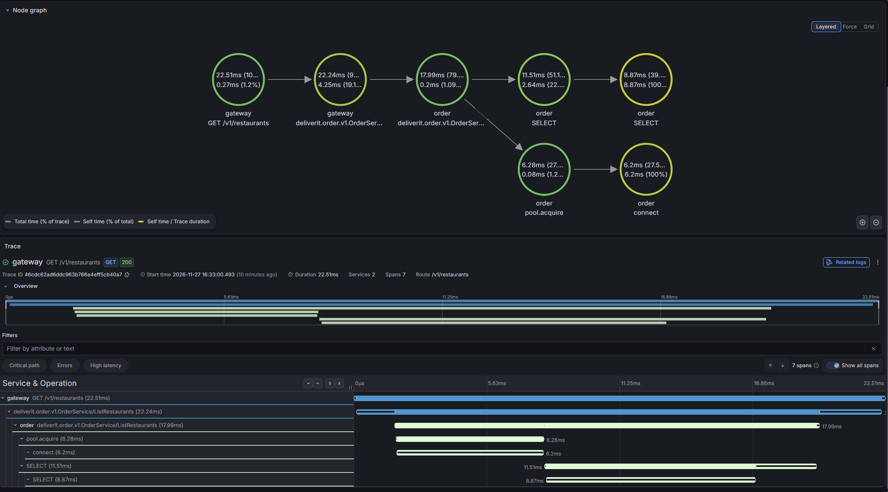

# DeliverIt

[](https://github.com/Yulian302/deliverit/actions/workflows/ci.yml)

DeliverIt is a food-delivery platform written in Go. Customers order from restaurants, restaurants prepare the food, and the system sends a nearby courier, with live tracking on a map. It's a learning and portfolio project about production-grade distributed systems: idempotency, a transactional outbox, event-driven services, geo-matching and observability. Understanding every part matters more than adding features.

**Status:** slice 1 of 8, the walking skeleton. A request goes through the Gateway to the Order service and into Postgres, and the whole path appears as one trace in Grafana. CI runs lint, tests, generated-code drift checks, a vulnerability scan and an end-to-end smoke test.



## Prerequisites

- Docker with Compose v2 (`docker compose`)
- Go, at the version in [go.mod](go.mod) (only needed to develop, not to run the stack)
- `curl` and `jq` (used by `make smoke`)

## Quick start

```bash
make up      # build images and start the whole stack; returns once everything is healthy
make smoke   # end-to-end check against the running stack
make down    # stop the stack (Postgres data is kept)
make clean   # stop the stack and delete its data (fresh database next `make up`)
```

`make smoke` checks that a search returns the 10 seeded restaurants nearest first, that bad input gets a `400 application/problem+json` response, and that the request shows up in Tempo as one trace (gateway → order → postgres) with its logs in Loki. It finishes by printing the trace ID so you can open it in Grafana.

Try the API yourself:

```bash
curl -s 'http://localhost:8080/v1/restaurants?near=50.4501,30.5234' | jq
```

`make logs` follows every service (`make logs svc=order` for one), and `make ps` shows container health.

## Local URLs

| What | URL |
|---|---|
| Gateway (public API) | http://localhost:8080 |
| Order (Connect, for debugging) | http://localhost:8081 |
| Grafana (traces, logs, metrics) | http://localhost:3000 |
| Kafka UI | http://localhost:8090 |
| OTLP gRPC / HTTP (for services run locally) | localhost:4317 / localhost:4318 |
| Postgres | localhost:5433 |
| Redis | localhost:6379 |
| Kafka | localhost:9094 |

Each service has `/livez` and `/readyz` health endpoints.

## Development

```bash
make test       # unit tests with the race detector, in random order
make test-int   # unit + integration tests (needs Docker: starts real Postgres etc.)
make lint       # golangci-lint (pinned version, no global install needed)
make gen        # regenerate protobuf (buf) and SQL (sqlc) code; commit the result
make gen-check  # fail if regenerating changes any file (CI runs this)
```

Run a service outside Docker:

```bash
make db-up        # throwaway Postgres on localhost:5432 (removed on db-down)
make migrate      # apply Order's migrations
make run-order    # Order with services/order/.env
make run-gateway  # Gateway with services/gateway/.env
make db-down      # stop and remove the local Postgres
```

The first run creates each service's `.env` from its committed `.env.example`. `make migration name=<snake_case_name>` adds a new Order migration.

## Repository layout

| Path | Contents |
|---|---|
| [services/](services/) | Deployable services: `gateway` (public HTTP API) and `order` (restaurant catalog; placing orders arrives in slice 2) |
| [platform/](platform/) | Shared building blocks: config, logging, telemetry, health, HTTP server, RPC, Postgres |
| [proto/](proto/) | Protobuf contracts between services |
| [gen/](gen/) | Code generated from `proto/` (committed; checked by `make gen-check`) |
| [api/](api/) | OpenAPI description of the public HTTP API |
| [deploy/](deploy/) | Docker Compose stack for local runs |
| [scripts/](scripts/) | End-to-end smoke test |
| [tools/](tools/) | Pinned dev tools (buf, protoc plugins, goose) in their own Go module |
| [docs/](docs/) | Design spec and implementation plans |

## Design

[docs/SPEC.md](docs/SPEC.md) is the full MVP design: services, events, state machines, failure handling, and the acceptance criteria each slice works toward.
